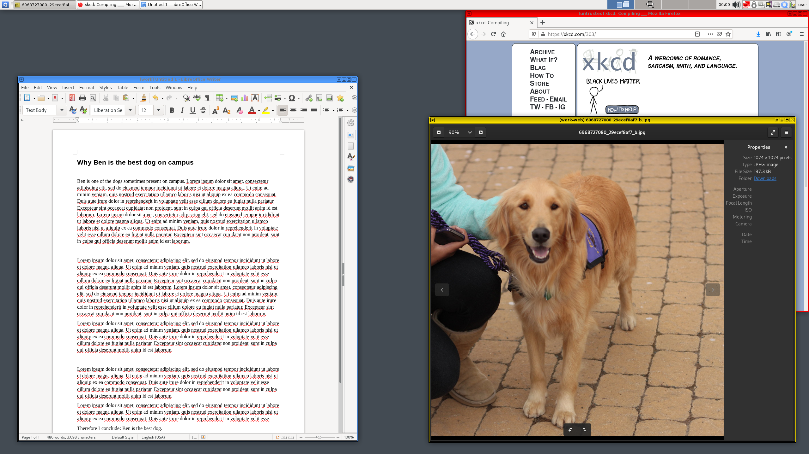

الـ [**Qubes OS**](../desktop.md#qubes-os) هو نظام تشغيل مفتوح المصدر يستخدم [Xen](https://en.wikipedia.org/wiki/Xen) hypervisor لتوفير مستوى عالٍ من الأمان على أجهزة الكمبيوتر، من خلال بيئات معزولة تُسمى *qubes*، وهي أجهزة افتراضية (Virtual Machines). يمكنك تحديد مستوى الثقة في كل *qube* حسب الغرض من استخدامها. يوفر Qubes OS الأمان من خلال العزل. فهو لا يسمح بتنفيذ الإجراءات إلا بعد السماح بها لكل حالة على حدة، بدلًا من الاعتماد على حصر السلوكيات [الضارة المعروفة](https://ranum.com/security/computer_security/editorials/dumb) ومنعها.

## كيف يعمل Qubes OS؟

يستخدم Qubes [العزل](https://qubes-os.org/intro) بين أجزاء النظام المختلفة للحفاظ على أمانه. تُنشأ qubes باستخدام قوالب (Templates)، والقوالب الافتراضية مبنية على Fedora وDebian [وWhonix](../desktop.md#whonix). يتيح لك Qubes OS أيضا إنشاء *qubes* مؤقتة[ تُستخدم مرة واحدة فقط](https://qubes-os.org/doc/how-to-use-disposables).

يجري تدريجيا تحديث المصطلحات المستخدمة، بحيث يُشار إلى هذه البيئات باسم <em>"qubes"</em> بدلا من "virtual machines".

قد تجد بعض الاختلافات في المصطلحات المستخدمة هنا وفي وثائق Qubes OS، لأن مصطلح "appVM" يُستبدل تدريجيا بمصطلح "qube". ليست qubes أجهزة افتراضية كاملة، لكنها توفر وظائف مشابهة لما تقدمه الأجهزة الافتراضية (VMs).

<figcaption>بنية Qubes، المصدر: What is Qubes OS Intro</figcaption>

تظهر نوافذ التطبيقات التابعة لكل qube [بإطار ملون](https://qubes-os.org/screenshots) يساعدك على معرفة الـqube التي تعمل بداخلها. يمكنك مثلا تخصيص لون معين للمتصفح الذي تستخدمه للخدمات البنكية، ولون مختلف للمتصفح الذي تستخدمه للتصفح العام ولا تعتبره موثوقا.

<figcaption>إطارات النوافذ في Qubes، المصدر: Qubes Screenshots</figcaption>

## لماذا أستخدم Qubes؟

يكون Qubes OS مفيدا إذا كان [Threat Model](../basics/threat-modeling.md) الخاص بك يتطلب مستوى عاليا من الأمان والعزل، مثلا إذا كنت تتوقع فتح ملفات غير موثوقة من مصادر غير موثوقة. من الأسباب الشائعة لاستخدام Qubes OS مثلا فتح مستندات من مصادر غير معروفة. والفكرة هي أن اختراق qube واحدة لا يؤثر على بقية النظام.

في Qubes OS، توجد بيئة خاصة تُسمّى [dom0](https://wiki.xenproject.org/wiki/Dom0)، وهي المسؤولة عن إدارة بقية الـ*qubes*. ورغم أن التطبيقات تعمل داخل qubes منفصلة ومعزولة عن بعضها، فإن نوافذها تظهر معًا على سطح المكتب الذي تديره dom0. لهذا النوع من البنية استخدامات كثيرة. إليك بعض المهام التي يمكنك تنفيذها. يمكنك ملاحظة كيف أن إضافة عدة خطوات تجعل هذه العمليات أكثر أمانا بكثير.

### نسخ النصوص ولصقها

يمكنك[ نسخ النصوص ولصقها](https://qubes-os.org/doc/how-to-copy-and-paste-text) باستخدام `qvm-copy-to-vm` أو باتباع التعليمات التالية:

1. اضغط على **Ctrl+C** لنسخ المحتوى داخل الـ*qube* التي تستخدمها.
2. اضغط على **Ctrl+Shift+C** لجعل المحتوى المنسوخ داخل الـ*qube* متاحًا في الحافظة العامة.
3. اضغط على **Ctrl+Shift+V** داخل الـ*qube* التي تريد لصق المحتوى فيها، لإتاحة محتوى الحافظة العامة داخلها.
4. اضغط على **Ctrl+V** داخل الـ*qube *التي تريد لصق المحتوى فيها، للصق النص الموجود في الحافظة.

### نقل الملفات

لنسخ الملفات والمجلدات أو نقلها من *qube* إلى أخرى، يمكنك استخدام الخيار **Copy to Other AppVM**... أو **Move to Other AppVM**. الفرق هو أن خيار **Move** يحذف الملف الأصلي بعد نقله. يحمي كلا الخيارين محتويات الحافظة من التسرب إلى أي *qubes* أخرى. نقل الملفات بين الـqubes بهذه الطريقة أكثر أمانا من نقلها باستخدام فلاشة USB بين جهازين منفصلين وغير متصلين بالشبكة (air-gapped)، لأن النظام لا يحتاج إلى قراءة نظام ملفات الفلاشة، مما يقلل بعض المخاطر الأمنية. حتى الكمبيوتر المعزول تماما عن الشبكات (air-gapped) سيظل مضطرًا إلى قراءة وتحليل الـ (partitions) أو أنظمة الملفات (file systems). أما عند نسخ الملفات بين الـqubes، فلا حاجة لقراءة وتحليل أقسام التخزين أو أنظمة الملفات بهذه الطريقة.

لا تمتلك الـqubes أنظمة ملفات مستقلة خاصة بها.

يمكنك [نسخ الملفات ونقلها](https://qubes-os.org/doc/how-to-copy-and-move-files) بين الـ*qubes*. عند نسخ الملفات أو نقلها بين الـqubes، تُطبق التغييرات فورا، وقد يصعب التراجع عنها إذا حدث خطأ. عند تشغيل *qube*، لا يكون لديها نظام ملفات يحتفظ بالتغييرات بشكل دائم. يمكنك إنشاء الملفات وحذفها، لكن هذه التغييرات تكون مؤقتة ولا تُحفظ بشكل دائم.

### التفاعل بين الأجهزة الافتراضية

يُعدّ إطار العمل [qrexec](https://qubes-os.org/doc/qrexec) جزءًا أساسيًا من Qubes، ويتيح التواصل بين البيئات المعزولة المختلفة (domains). يعتمد qrexec على مكتبة *vchan* التابعة لـXen، التي تتيح التواصل بين الـqubes، ويستخدم سياسات أمنية لتحديد الاتصالات المسموح بها مع الحفاظ على [العزل بينها](https://qubes-os.org/news/2020/06/22/new-qrexec-policy-system).

## الاتصال بشبكة Tor عبر VPN

[نوصي](../advanced/tor-overview.md) بالاتصال بشبكة Tor عبر مزود [VPN](../vpn.md) موثوق، ولحسن الحظ، يسهّل Qubes القيام بذلك باستخدام ProxyVMs وWhonix معًا.

[بعد إنشاء ProxyVM ](https://forum.qubes-os.org/t/configuring-a-proxyvm-vpn-gateway/19061)جديدة تتصل بخدمة الـVPN من اختيارك، يمكنك جعل الـqubes الخاصة بـWhonix تتصل بشبكة Tor عبر هذه الـProxyVM. وللقيام بذلك، اضبط إعداد NetVM في الـ Whonix **Gateway** `(sys-whonix)` على الـProxyVM التي أنشأتها.

يُفترض أن يكون إعداد الـqubes لديك مشابهًا لما يلي:

| اسم الـqube     | وصف الـqube                                                                                         | NetVM           |
| --------------- | --------------------------------------------------------------------------------------------------- | --------------- |
| sys-net         | *Your default network qube (pre-installed)*                                                         | *n/a*           |
| sys-firewall    | *Your default firewall qube (pre-installed)*                                                        | sys-net         |
| ==sys-proxyvm== | الـVPN ProxyVM التي [أنشأتها](https://forum.qubes-os.org/t/configuring-a-proxyvm-vpn-gateway/19061) | sys-firewall    |
| sys-whonix      | Your Whonix Gateway VM                                                                              | ==sys-proxyvm== |
| anon-whonix     | Your Whonix Workstation VM                                                                          | sys-whonix      |

## مصادر إضافية

لمزيد من المعلومات، ننصحك بالاطلاع على وثائق Qubes OS المفصلة والمتوفرة على [موقع Qubes OS](https://qubes-os.org/doc). يمكنك تنزيل نسخ من الوثائق لاستخدامها دون اتصال بالإنترنت من [وثائق Qubes OS](https://github.com/QubesOS/qubes-doc).

- [يمكن القول إنه نظام التشغيل الأكثر أمانا في العالم ](https://opentech.fund/news/qubes-os-arguably-the-worlds-most-secure-operating-system-motherboard)(Open Technology Fund)
- [العزل باستخدام البرامج مقابل الفصل بين الأجهزة](https://invisiblethingslab.com/resources/2014/Software_compartmentalization_vs_physical_separation.pdf)(J. Rutkowska)
- [تقسيم حياتي الرقمية إلى نطاقات أمنية ](https://blog.invisiblethings.org/2011/03/13/partitioning-my-digital-life-into.html)(J. Rutkowska)
- [مقالات ذات صلة](https://qubes-os.org/news/categories/#articles) (Qubes OS)
