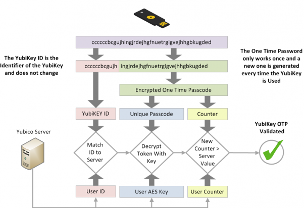
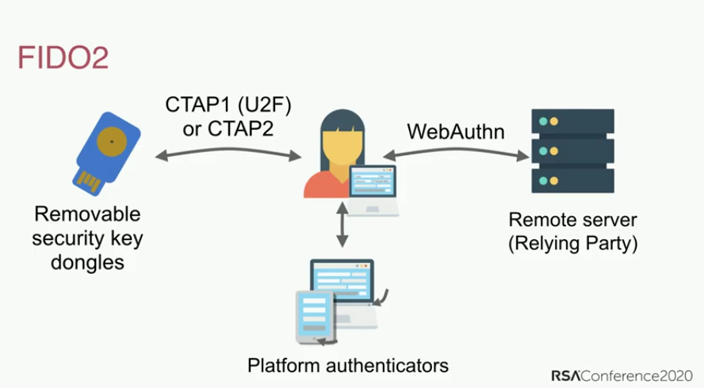

**다중 인증**(**MFA**)은 사용자 이름(또는 이메일)과 비밀번호를 입력하는 것 외에 추가 단계를 요구하는 보안 메커니즘입니다. 가장 흔한 방식은 SMS나 앱으로 받는 시간 제한 코드입니다.

일반적으로 해커(또는 공격자)가 여러분의 비밀번호를 알아내면 그 비밀번호에 해당하는 계정에 접근할 수 있습니다. MFA가 적용된 계정이라면 해커는 비밀번호(여러분이 *알고 있는* 것)와 휴대폰처럼 여러분이 소유한 기기(여러분이 *가지고 있는* 것)를 모두 손에 넣어야 합니다.

MFA 방식마다 보안 수준은 다르지만, 공격자가 여러분의 MFA 수단에 접근하기 어려울수록 더 좋다는 전제는 같습니다. MFA 방식의 예로는 (가장 약한 것부터 강한 순으로) SMS, 이메일 코드, 앱 푸시 알림, TOTP, 유비코 OTP, FIDO가 있습니다.

## MFA 방식 비교 { #mfa-method-comparison }

### SMS 또는 이메일 MFA { #sms-or-email-mfa }

SMS나 이메일로 OTP 코드를 받는 방식은 MFA로 계정을 보호하는 방법 중 취약한 편에 속합니다. 해커가 여러분의 기기에 물리적으로 전혀 접근하지 않고도 [전화번호를 탈취](https://en.wikipedia.org/wiki/SIM_swap_scam)하거나 이메일에 접근할 수 있는 방법은 다양하기 때문에, 이메일이나 SMS로 코드를 받는 방식은 "여러분이 *가지고 있는* 것"이라는 개념을 퇴색시킵니다. 권한 없는 사람이 여러분의 이메일에 접근하면, 그 접근 권한을 이용해 비밀번호를 재설정하고 인증 코드도 받아 계정에 완전히 접근할 수 있습니다.

### 푸시 알림 { #push-notifications }

푸시 알림 MFA는 새 계정 로그인을 확인해 달라는 메시지를 휴대폰의 앱으로 보내는 방식입니다. 이 방식은 SMS나 이메일보다 훨씬 낫습니다. 공격자는 일반적으로 이미 로그인된 기기 없이는 푸시 알림을 받을 수 없으므로, 먼저 여러분의 다른 기기 중 하나를 장악해야 하기 때문입니다.

하지만 누구나 실수를 하기 마련이고, 실수로 로그인 시도를 승인할 위험이 있습니다. 푸시 알림 로그인 승인 요청은 보통 여러분의 *모든* 기기에 한꺼번에 전송되므로, 기기가 많을수록 MFA 코드에 접근할 수 있는 경로가 넓어집니다.

푸시 알림 MFA의 보안은 앱의 품질, 서버 구성 요소, 그리고 앱을 만든 개발자에 대한 신뢰에 따라 달라집니다. 또한 앱을 설치할 때 기기의 다른 데이터에 접근할 수 있는 침해적인 권한을 허용해야 할 수도 있습니다. 게다가 이 방식은 서비스마다 전용 앱이 필요한데, 좋은 TOTP 생성기 앱과 달리 이러한 앱은 열 때 비밀번호를 요구하지 않을 수도 있습니다.

### 시간 기반 일회용 비밀번호(TOTP) { #time-based-one-time-password-totp }

TOTP는 가장 널리 사용되는 MFA 방식 중 하나입니다. TOTP를 설정할 때는 일반적으로 [QR 코드](https://en.wikipedia.org/wiki/QR_code)를 스캔하여 사용하려는 서비스와 "[공유 비밀](https://en.wikipedia.org/wiki/Shared_secret)"을 설정해야 합니다. 공유 비밀은 인증 앱의 데이터 안에 안전하게 보관되며, 경우에 따라 비밀번호로 보호되기도 합니다.

시간 제한 코드는 공유 비밀과 현재 시간 정보를 기반으로 만들어집니다. 코드는 짧은 시간 동안만 유효하므로 공격자는 공유 비밀에 접근하지 않고서는 새로운 코드를 생성할 수 없습니다.

TOTP를 지원하는 하드웨어 보안 키(예: [유비코 오센티케이터](https://yubico.com/products/yubico-authenticator)를 사용하는 유비키)가 있다면 "공유 비밀"을 하드웨어에 저장하는 것을 권장합니다. 유비키 같은 하드웨어는 "공유 비밀"을 추출하거나 복사하기 어렵게 만들 목적으로 개발되었습니다. 또한 TOTP 앱이 설치된 휴대폰과 달리 유비키는 인터넷에 연결되어 있지 않습니다.

[WebAuthn](#fido-fast-identity-online)과 달리 TOTP는 [피싱](https://en.wikipedia.org/wiki/Phishing)이나 재사용 공격을 막아 주지 못합니다. 만약 공격자가 여러분의 유효 코드를 탈취해낸다면, 공격자는 해당 코드가 만료될 때까지(보통 60초) 몇 번이고 사용할 수 있습니다.

공격자는 공식 서비스를 흉내 낸 웹사이트를 만들어 여러분이 사용자 이름, 비밀번호, 현재 TOTP 코드를 입력하도록 속일 수 있습니다. 공격자가 이렇게 기록한 자격 증명을 사용하면 실제 서비스에 로그인하여 계정을 탈취할 수 있습니다.

TOTP는 완벽하지는 않지만 대부분의 사람에게 충분히 안전하며, [하드웨어 보안 키](../security-keys.md)가 지원되지 않을 때는 [인증 앱](../multi-factor-authentication.md)이 여전히 좋은 선택지입니다.

### 하드웨어 보안 키 { #hardware-security-keys }

유비키는 변조 방지 솔리드 스테이트 칩에 데이터를 저장하며, 이 칩은 고비용의 공정과 포렌식 연구소 없이는 비파괴적으로 [접근하는 것이 불가능합니다](https://security.stackexchange.com/a/245772).

이러한 키는 보통 여러 기능을 갖추고 있으며 다양한 인증 방식을 제공합니다. 가장 일반적인 방식은 다음과 같습니다.

#### 유비코 OTP { #yubico-otp }

유비코 OTP는 일반적으로 하드웨어 보안 키에 구현되는 인증 프로토콜입니다. 유비코 OTP를 사용하기로 하면 키가 공개 ID, 비공개 ID, 비밀 키를 생성하고, 이 정보가 유비코 OTP 서버에 업로드됩니다.

웹사이트에 로그인하려면 보안 키를 물리적으로 터치하기만 하면 됩니다. 보안 키는 키보드를 에뮬레이트하여 비밀번호 입력란에 일회용 비밀번호를 입력합니다.

그러면 서비스는 검증을 위해 일회용 비밀번호를 유비코 OTP 서버로 전달합니다. 키와 유비코 검증 서버 양쪽에서 카운터가 증가합니다. OTP는 한 번만 사용할 수 있으며, 인증에 성공하면 카운터가 증가함으로써 OTP 재사용을 방지합니다. 유비코는 이 과정에 대한 [상세 문서](https://developers.yubico.com/OTP/OTPs_Explained.html)를 제공합니다.

<figure markdown>
  
</figure>

유비코 OTP는 TOTP와 비교했을 때 몇 가지 장단점이 있습니다.

유비코 검증 서버는 클라우드 기반 서비스이므로, 유비코가 데이터를 안전하게 저장하고 여러분을 프로파일링하지 않을 것이라고 신뢰해야 합니다. 유비코 OTP와 연결된 공개 ID는 모든 웹사이트에서 재사용되므로 제3자가 여러분을 프로파일링하는 또 다른 수단이 될 수 있습니다. TOTP와 마찬가지로 유비코 OTP도 피싱 방지 기능을 제공하지 않습니다.

위협 모델상 웹사이트마다 서로 다른 신원을 사용해야 한다면, 공개 ID가 보안 키마다 고유하므로 해당 웹사이트들에서 같은 하드웨어 보안 키로 유비코 OTP를 사용해서는 **안 됩니다**.

#### FIDO (Fast IDentity Online)

[FIDO](https://en.wikipedia.org/wiki/FIDO_Alliance)에는 여러 표준이 포함되어 있는데, 처음에는 [U2F](https://en.wikipedia.org/wiki/Universal_2nd_Factor)가 있었고 이후 웹 표준인 [WebAuthn](https://en.wikipedia.org/wiki/WebAuthn)을 포함하는 [FIDO2](https://en.wikipedia.org/wiki/FIDO2_Project)가 나왔습니다.

U2F와 FIDO2는 보안 키와 노트북이나 휴대폰 같은 컴퓨터 사이의 프로토콜인 [클라이언트-인증기 프로토콜(CTAP)](https://en.wikipedia.org/wiki/Client_to_Authenticator_Protocol)을 가리킵니다. 이는 여러분이 로그인하려는 웹사이트("신뢰 당사자")와의 인증에 사용되는 구성 요소인 WebAuthn을 보완합니다.

WebAuthn은 가장 안전하고 프라이버시를 보호하는 형태의 2차 인증입니다. 인증 경험은 유비코 OTP와 비슷하지만, 키가 일회용 비밀번호를 입력하거나 제3자 서버에서 검증하지 않습니다. 대신 인증에 [공개 키 암호 방식](https://en.wikipedia.org/wiki/Public-key_cryptography)을 사용합니다.

<figure markdown>
  
</figure>

계정을 만들 때 공개 키가 서비스로 전송되고, 이후 로그인할 때 서비스는 여러분의 개인 키로 일부 데이터에 "서명"하도록 요구합니다. 이 방식의 장점은 서비스에 비밀번호 데이터가 전혀 저장되지 않으므로 공격자가 훔칠 것이 없다는 점입니다.

이 발표에서는 비밀번호 인증의 역사, (비밀번호 재사용 같은) 함정, 그리고 FIDO2와 [WebAuthn](https://webauthn.guide) 표준에 대해 다룹니다:

- [FIDO2와 WebAuthn이 계정 탈취를 막는 방법](https://youtu.be/aMo4ZlWznao) <small>(유튜브)</small>

FIDO2와 WebAuthn은 다른 어떤 MFA 방식보다도 뛰어난 보안성과 프라이버시를 제공합니다.

웹 서비스에서는 보통 [W3C 권고안](https://en.wikipedia.org/wiki/World_Wide_Web_Consortium#W3C_recommendation_(REC))의 일부인 WebAuthn과 함께 사용됩니다. WebAuthn은 공개 키 인증을 사용하며 인증 시 출처(보통은 도메인 이름)를 포함하므로, 유비코 OTP나 TOTP 방식에 사용되는 공유 비밀보다 안전합니다. 증명(Attestation)은 여러분이 가짜가 아닌 진짜 서비스를 사용하고 있는지 확인하는 데 도움을 주어 피싱 공격으로부터 보호합니다.

유비코 OTP와 달리 WebAuthn은 공개 ID를 사용하지 않으므로, 서로 다른 웹사이트에서 키를 식별하는 것이 **불가능합니다**. 인증 과정에 제3자 클라우드 서버를 사용하지도 않습니다. 모든 통신은 키와 여러분이 로그인하려는 웹사이트 사이에서만 이루어집니다. FIDO도 세션 재사용과 키 복제를 막기 위해 사용할 때마다 증가하는 카운터를 사용합니다.

웹사이트나 서비스가 WebAuthn 인증을 지원한다면 다른 어떤 MFA 방식보다 WebAuthn을 사용할 것을 강력히 권장합니다.

## 일반 권장 사항 { #general-recommendations }

일반적인 권장 사항은 다음과 같습니다:

### 어떤 방식을 사용해야 하나요? { #which-method-should-i-use }

MFA 방식을 구성할 때는 보안 수준이 여러분이 사용하는 인증 방식 중 가장 약한 방식의 수준에 불과하다는 점을 명심하세요. 따라서 사용 가능한 최선의 MFA 방식만 사용하는 것이 중요합니다. 예를 들어, TOTP를 이미 사용하고 있다면 SMS/이메일 MFA를 비활성화해야 합니다. 이미 FIDO2/WebAuthn을 사용하고 있다면 해당 계정에서 유비코 OTP나 TOTP를 사용해서는 안 됩니다.

### 백업 { #backups }

MFA 수단은 항상 백업해 두어야 합니다. 하드웨어 보안 키는 분실하거나 도난당할 수 있고, 시간이 지나면서 그냥 고장 날 수도 있습니다. 하드웨어 보안 키를 하나만 두지 말고, 계정에 동일하게 접근할 수 있는 키를 한 쌍으로 마련하는 것이 좋습니다.

인증 앱으로 TOTP를 사용할 때는 복구 키나 앱 자체를 반드시 백업하거나, "공유 비밀"을 다른 휴대폰의 같은 앱이나 암호화된 컨테이너(예: [베라크립트](../encryption.md#veracrypt-disk))에 복사해 두세요.

### 초기 설정 { #initial-set-up }

보안 키를 구매했다면 기본 자격 증명을 변경하고, 키에 비밀번호 보호를 설정하고, 키가 지원한다면 터치 확인을 활성화하는 것이 중요합니다. 유비키 같은 제품은 인터페이스가 여러 개이고 각각 별도의 자격 증명을 사용하므로, 인터페이스마다 살펴보고 보호 설정을 해야 합니다.

### 이메일 및 SMS { #email-and-sms }

이메일로 MFA를 사용해야 한다면 해당 이메일 계정 자체가 적절한 MFA 방식으로 보호되고 있는지 확인하세요.

SMS MFA를 사용한다면 [SIM 스와핑 공격](https://en.wikipedia.org/wiki/SIM_swap_scam)을 피하기 위해 계정 접근 없이는 전화번호를 새 SIM 카드로 옮겨 주지 않는 통신사를 이용하거나, 비슷한 수준의 보안을 갖춘 제공업체의 전용 VoIP 번호를 사용하세요.

[추천 MFA 도구](../multi-factor-authentication.md ""){.md-button}

## MFA를 설정할 수 있는 다른 곳 { #more-places-to-set-up-mfa }

다중 인증은 웹사이트 로그인뿐만 아니라 로컬 로그인, SSH 키, 심지어 비밀번호 데이터베이스를 보호하는 데에도 사용할 수 있습니다.

### macOS

macOS는 스마트 카드(PIV)를 이용한 인증을 [기본 지원](https://support.apple.com/guide/deployment/intro-to-smart-card-integration-depd0b888248/web)합니다. 유비키처럼 PIV 인터페이스를 지원하는 스마트 카드나 하드웨어 보안 키가 있다면, 스마트 카드나 하드웨어 보안 키 제조사의 문서를 따라 macOS 컴퓨터에 2차 인증을 설정하는 것을 권장합니다.

유비코에서 제공하는 [macOS에서 유비키를 스마트 카드로 사용하기](https://support.yubico.com/hc/articles/360016649059) 가이드를 참고하면 macOS에서 유비키를 설정하는 데 도움이 됩니다.

스마트 카드/보안 키를 설정한 후에는 터미널에서 다음 명령을 실행할 것을 권장합니다:

```text
sudo defaults write /Library/Preferences/com.apple.loginwindow DisableFDEAutoLogin -bool YES
```

이 명령은 컴퓨터가 부팅될 때 공격자가 MFA를 우회하지 못하게 합니다.

### 리눅스 { #linux }

<div class="admonition warning" markdown>
<p class="admonition-title">경고</p>

(DHCP 등으로 인해) 시스템의 호스트 이름이 변경되면 로그인할 수 없게 됩니다. 이 가이드를 따르기 전에 컴퓨터에 적절한 호스트 이름을 설정해 두는 것이 매우 중요합니다.

</div>

리눅스의 `pam_u2f` 모듈을 사용하면 대부분의 인기 리눅스 배포판에서 로그인 시 2단계 인증을 적용할 수 있습니다. U2F를 지원하는 하드웨어 보안 키가 있다면 로그인에 MFA 인증을 설정할 수 있습니다. 유비코의 [우분투 리눅스 로그인 가이드 - U2F](https://support.yubico.com/s/article/Ubuntu-Linux-login-guide-U2F)는 어느 배포판에서든 사용할 수 있을 것입니다. 다만 `apt-get` 같은 패키지 관리자 명령어와 패키지 이름은 다를 수 있습니다. 이 가이드는 큐브스 OS에는 적용되지 **않습니다**.

### 큐브스 OS { #qubes-os }

큐브스 OS는 유비키를 이용한 챌린지-응답 인증을 지원합니다. 챌린지-응답 인증을 지원하는 유비키가 있고 큐브스 OS에 MFA를 설정하고 싶다면 큐브스 OS의 [유비키 문서](https://qubes-os.org/doc/yubikey)를 참고하세요.

### SSH

#### 하드웨어 보안 키 { #hardware-security-keys_1 }

SSH MFA는 하드웨어 보안 키에서 널리 쓰이는 여러 인증 방식으로 설정할 수 있습니다. 설정 방법은 유비코의 [문서](https://developers.yubico.com/SSH)를 참고할 것을 권장합니다.

#### TOTP

SSH MFA는 TOTP로도 설정할 수 있습니다. 디지털오션에서 [우분투 20.04에서 SSH 다중 인증을 설정하는 방법](https://digitalocean.com/community/tutorials/how-to-set-up-multi-factor-authentication-for-ssh-on-ubuntu-20-04) 튜토리얼을 제공합니다. 배포판에 관계없이 대부분 동일하겠지만, `apt-get` 같은 패키지 관리자 명령어와 패키지 이름은 다를 수 있습니다.

### 키패스(및 키패스XC) { #keepass-and-keepassxc }

키패스와 키패스XC 데이터베이스는 HOTP나 챌린지-응답을 2차 인증 요소로 사용하여 보호할 수 있습니다. 유비코에서 키패스용 문서인 [키패스에서 유비키 사용하기](https://support.yubico.com/hc/articles/360013779759-Using-Your-YubiKey-with-KeePass)를 제공하며, [키패스XC](https://keepassxc.org/docs/#faq-yubikey-2fa) 웹사이트에도 관련 문서가 있습니다.
