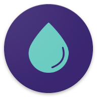
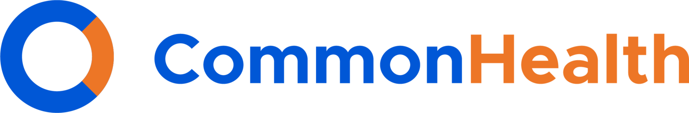

<small>다음 위협으로부터 보호합니다:</small>

- [:material-server-network: 서비스 제공업체](basics/common-threats.md#privacy-from-service-providers){ .pg-teal }

이 앱으로 건강 및 피트니스 관련 목표를 관리하세요. 주류 대안과 달리 개인 건강 정보가 비공개로 유지됩니다.

## 생리 주기 추적 { #menstrual-cycle-tracking }

[플로](https://techcrunch.com/2021/01/13/flo-gets-ftc-slap-for-sharing-user-data-when-it-promised-privacy) 같은 인기 생리 주기 추적 앱은 사용자 데이터를 수집하고 공유하는 것으로 악명이 높습니다. 관할 지역에 따라 이는 재생산 자율성에 영향을 미치는 [법적 결과](https://forbes.com/sites/abigaildubiniecki/2024/11/14/post-roe-your-period-app-data-could-be-used-against-you)로 이어질 수 있습니다.

### 드립 { #drip }

{ align=right }

**드립**은 모든 모바일 플랫폼에서 사용할 수 있는, 성별을 포용하는 오픈 소스 생리 주기 추적 앱입니다. 배란일을 예측하는 데 "증상체온법"을 사용합니다. 모든 사용자 데이터는 기기에 로컬로 저장되며 비밀번호로 보호할 수 있습니다.

[:octicons-home-16: 홈페이지](https://bloodyhealth.gitlab.io){ .md-button .md-button--primary }
[:octicons-eye-16:](https://bloodyhealth.gitlab.io/privacy-policy.html){ .card-link title="개인정보 처리방침" }
[:octicons-info-16:](https://bloodyhealth.gitlab.io/faq){ .card-link title="문서" }
[:octicons-code-16:](https://gitlab.com/bloodyhealth/drip){ .card-link title="소스 코드" }

다운로드

- [:simple-googleplay: 구글 플레이](https://play.google.com/store/apps/details?id=com.drip)
- [:simple-appstore: 앱 스토어](https://apps.apple.com/us/app/drip/id1584564949)
- [:simple-android: 안드로이드](https://bloodyhealth.gitlab.io)

### 유키 { #euki }

{ align=right }

**유키**는 비영리 단체의 지원을 받는 생리 주기 추적 앱으로, 복약 관리 도구와 성 건강 지식 자료 역할도 합니다. 앱 안의 개인 데이터가 자동으로 삭제되도록 예약할 수 있습니다. 모든 사용자 데이터는 기기에 로컬로 저장되며 비밀번호로 보호할 수 있습니다.

[:octicons-home-16: 홈페이지](https://eukiapp.org){ .md-button .md-button--primary }
[:octicons-eye-16:](https://eukiapp.org/privacy-policy){ .card-link title="개인정보 처리방침" }
[:octicons-code-16:](https://github.com/Euki-Inc/Euki-Android){ .card-link title="소스 코드" }
[:octicons-heart-16:](https://every.org/euki-app){ .card-link title="후원하기" }

다운로드

- [:simple-googleplay: 구글 플레이](https://play.google.com/store/apps/details?id=com.kollectivemobile.euki)
- [:simple-appstore: 앱 스토어](https://apps.apple.com/app/euki/id1469213846)

### 애플 건강 { #apple-health }

{ align=right }{ align=right }

애플 건강은 iOS 기기에 기본으로 설치되는 앱 중 하나입니다. 생리 주기 추적을 비롯해 많은 건강 및 웰니스 기능([건강 기록](#apple-health-records) 참조)을 갖추고 있습니다. 또한 성 중립적인 언어를 사용합니다. 애플 건강은 여러 기기 간에 동기화할 때 항상 종단 간 암호화를 사용합니다.

[:octicons-home-16: 홈페이지](https://apple.com/health){ .md-button .md-button--primary }
[:octicons-eye-16:](https://apple.com/legal/privacy/consumer-health-personal-data/en-ww){ .card-link title="개인정보 처리방침" }

다운로드

- [:simple-appstore: 앱 스토어](https://apps.apple.com/app/apple-health/id1242545199)

## 피트니스 트래커 { #fitness-trackers }

이 범용 앱은 걸음 수 측정, 수면 추적부터 심박수 측정까지 모든 것을 할 수 있습니다.

### 애플 피트니스 { #apple-fitness }

{ align=right }

**애플 피트니스**는 iOS의 기본 피트니스 앱입니다. 애플 피트니스는 여러 기기 간에 동기화할 때 항상 종단 간 암호화를 사용합니다. 또한 측정된 데이터의 거의 대부분이 기기에서 처리됩니다.

[:octicons-eye-16:](https://apple.com/legal/privacy/consumer-health-personal-data/en-ww){ .card-link title="개인정보 처리방침" }

다운로드

- [:simple-appstore: 앱 스토어](https://apps.apple.com/app/id1208224953)

### 가젯브리지 { #gadgetbridge }

{ align=right }{ align=right }

**가젯브리지**는 제조사의 애플리케이션에 의존하지 않고 블루투스 기기를 페어링하고 관리할 수 있는 오픈 소스 안드로이드 애플리케이션입니다. 호환되는 스마트워치와 페어링하면 제3자의 데이터 수집 없이 해당 스마트워치의 건강 및 웰니스 기능을 그대로 구현할 수 있습니다.

[:octicons-home-16: 홈페이지](https://gadgetbridge.org){ .md-button .md-button--primary }
[:octicons-info-16:](https://gadgetbridge.org/basics){ .card-link title="문서" }
[:octicons-code-16:](https://codeberg.org/Freeyourgadget/Gadgetbridge){ .card-link title="소스 코드" }
[:octicons-heart-16:](https://liberapay.com/Gadgetbridge/donate){ .card-link title="후원하기" }

다운로드

- [:simple-fdroid: F-Droid](https://f-droid.org/packages/nodomain.freeyourgadget.gadgetbridge)

가젯브리지 앱은 걸음 수 측정, 수면 추적, 심박수 모니터링 등을 포함한(이에 국한되지 않는) 기능을 제공합니다.

기기를 구매하기 전에 스마트워치 [호환 목록](https://gadgetbridge.org/gadgets)을 꼭 확인하세요. 일부 기기는 가젯브리지를 설치하기 전에 제조사의 앱을 다운로드하고 스마트워치를 제조사 서버에 연결해야 합니다.

## 건강 기록 { #health-records }

이 앱은 개인 건강 데이터를 수집하고 관리하며, 의료 서비스 제공자, 기관, 다른 앱과 공유하는 데 도움을 줍니다.

### 애플 건강 기록 { #apple-health-records }

{ align=right }{ align=right }

**애플 건강 기록**은 [애플 건강](#apple-health)에 내장된 기능으로, 건강 기록을 보고, 저장하고, 공유할 수 있습니다.

[:octicons-home-16: 홈페이지](https://apple.com/health){ .md-button .md-button--primary }
[:octicons-eye-16:](https://apple.com/legal/privacy/consumer-health-personal-data/en-ww){ .card-link title="개인정보 처리방침" }

다운로드

- [:simple-appstore: 앱 스토어](https://apps.apple.com/app/apple-health/id1242545199)

### 커먼헬스 { #commonhealth }

{ align=right }

**커먼헬스**는 전자 건강 기록에 접근하고 이를 의료 서비스 제공자와 안전하게 공유할 수 있게 해 주는, 프라이버시를 존중하는 안드로이드 앱입니다. 모든 건강 데이터는 기기에 저장되며 암호나 생체 인증으로 보호할 수 있습니다.

[:octicons-home-16: 홈페이지](https://commonhealth.org){ .md-button .md-button--primary }
[:octicons-eye-16:](https://commonhealth.org/privacy){ .card-link title="개인정보 처리방침" }

다운로드

- [:simple-googleplay: 구글 플레이](https://play.google.com/store/apps/details?id=org.thecommonsproject.android.phr)

커먼헬스는 미국에서만 사용할 수 있습니다. 앱 자체는 비공개 소스이지만, [개발자 SDK는 오픈 소스](https://github.com/the-commons-project)입니다.

## 평가 기준 { #criteria }

**프라이버시 가이드는 추천하는 어떠한 프로젝트와도 제휴 관계가 없습니다.** [표준 평가 기준](about/criteria.md)에 더해, 객관적인 추천을 제공할 수 있도록 명확한 요구 사항을 마련했습니다. 프로젝트를 선택해 사용하기 전에 이 목록을 숙지하고, 직접 조사하여 자신에게 맞는 선택인지 확인하시기 바랍니다.

### 최소 요구 사항 { #minimum-requirements }

- 자동 업데이트를 지원해야 합니다.
- 암호화되지 않은 데이터를 기기 밖에 저장해서는 안 됩니다.
- 오프라인에서 작동해야 합니다.
