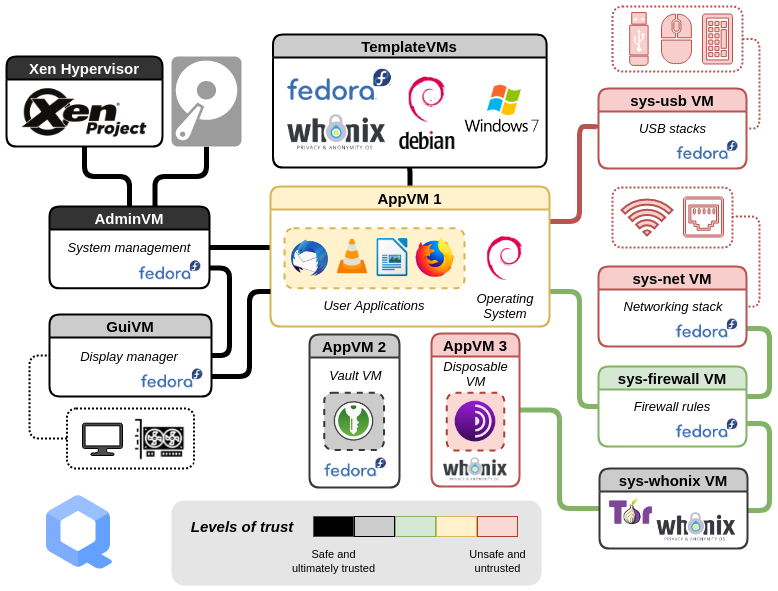

[**큐브스 OS**](../desktop.md#qubes-os)는 [Xen](https://en.wikipedia.org/wiki/Xen) 하이퍼바이저를 사용하여 격리된 *큐브*(가상 머신)를 통해 데스크톱 컴퓨팅에 강력한 보안을 제공하는 오픈 소스 운영 체제입니다. 각 *큐브*에는 용도에 따라 신뢰 수준을 지정할 수 있습니다. 큐브스 OS는 격리를 통해 보안을 제공합니다. 큐브스 OS는 사례별로만 작업을 허용하므로 [나쁜 것 열거하기](https://ranum.com/security/computer_security/editorials/dumb)와는 정반대입니다.

## 큐브스 OS는 어떻게 작동하나요? { #how-does-qubes-os-work }

큐브스는 [구획화](https://qubes-os.org/intro)를 사용하여 시스템을 안전하게 유지합니다. 큐브는 템플릿에서 생성되며, 기본 템플릿은 페도라, 데비안, [후닉스](../desktop.md#whonix)입니다. 큐브스 OS에서는 일회용 [디스포저블](https://qubes-os.org/doc/how-to-use-disposables) *큐브*도 만들 수 있습니다.

<em>큐브</em>라는 용어는 이를 "가상 머신"이라고 부르지 않도록 점차 업데이트되고 있습니다.

"appVM"이라는 용어가 점차 "큐브"로 바뀌고 있기 때문에, 이곳과 큐브스 OS 문서의 일부 정보에는 서로 상충하는 표현이 있을 수 있습니다. 큐브는 완전한 가상 머신은 아니지만, VM과 비슷한 기능을 유지합니다.

<figcaption>큐브스 아키텍처, 출처: What is Qubes OS Intro</figcaption>

각 큐브에는 해당 큐브가 실행되는 도메인을 쉽게 구분할 수 있도록 [색상 테두리](https://qubes-os.org/screenshots)가 있습니다. 예를 들어 은행 업무용 브라우저에는 특정 색상을, 신뢰할 수 없는 일반 브라우저에는 다른 색상을 사용할 수 있습니다.

<figcaption>큐브스 창 테두리, 출처: Qubes Screenshots</figcaption>

## 큐브스를 사용해야 하는 이유는 무엇인가요? { #why-should-i-use-qubes }

신뢰할 수 없는 출처의 신뢰할 수 없는 파일을 열게 될 것 같은 경우처럼 [위협 모델](../basics/threat-modeling.md)상 강력한 보안과 격리가 필요하다면 큐브스 OS가 유용합니다. 큐브스 OS를 사용하는 일반적인 이유는 출처를 알 수 없는 문서를 열기 위해서이며, 하나의 큐브가 침해되더라도 시스템의 나머지 부분에는 영향을 주지 않는다는 것이 핵심 개념입니다.

큐브스 OS는 [dom0](https://wiki.xenproject.org/wiki/Dom0) Xen VM을 사용하여 호스트 OS의 다른 *큐브*를 제어하며, 모든 큐브는 dom0의 데스크톱 환경 안에서 개별 애플리케이션 창을 표시합니다. 이러한 아키텍처는 다양한 용도로 활용할 수 있습니다. 다음은 수행할 수 있는 몇 가지 작업입니다. 여러 단계를 거치게 함으로써 이러한 과정이 얼마나 더 안전해지는지 확인할 수 있습니다.

### 텍스트 복사 및 붙여넣기 { #copying-and-pasting-text }

`qvm-copy-to-vm`이나 아래 방법을 사용하여 [텍스트를 복사하고 붙여넣을](https://qubes-os.org/doc/how-to-copy-and-paste-text) 수 있습니다:

1. **Ctrl+C**를 눌러 현재 사용 중인 *큐브*에 무언가를 복사하겠다고 알립니다.
2. **Ctrl+Shift+C**를 눌러 *큐브*가 이 버퍼를 전역 클립보드에서 사용할 수 있도록 합니다.
3. 대상 *큐브*에서 **Ctrl+Shift+V**를 눌러 전역 클립보드를 사용할 수 있도록 합니다.
4. 대상 *큐브*에서 **Ctrl+V**를 눌러 버퍼의 내용을 붙여넣습니다.

### 파일 교환 { #file-exchange }

한 *큐브*에서 다른 큐브로 파일과 디렉터리(폴더)를 복사하고 붙여넣으려면 **Copy to Other AppVM...** 또는 **Move to Other AppVM...** 옵션을 사용할 수 있습니다. 차이점은 **Move** 옵션은 원본 파일을 삭제한다는 것입니다. 두 옵션 모두 클립보드가 다른 *큐브*로 유출되지 않도록 보호합니다. 이는 에어갭 방식의 파일 전송보다 더 안전합니다. 에어갭 컴퓨터는 여전히 파티션이나 파일 시스템을 파싱해야 합니다. 큐브 간 복사 시스템에서는 그럴 필요가 없습니다.

큐브에는 자체 파일 시스템이 없습니다.

*큐브* 간에 [파일을 복사하고 이동](https://qubes-os.org/doc/how-to-copy-and-move-files)할 수 있습니다. 이때 변경 사항은 즉시 적용되지 않으며, 실수한 경우 쉽게 되돌릴 수 있습니다. *큐브*를 실행해도 큐브에는 영구적인 파일 시스템이 없습니다. 파일을 만들고 삭제할 수는 있지만, 이러한 변경 사항은 일시적입니다.

### VM 간 상호 작용 { #inter-vm-interactions }

[qrexec 프레임워크](https://qubes-os.org/doc/qrexec)는 도메인 간 통신을 가능하게 하는 큐브스의 핵심 구성 요소입니다. 이는 [정책을 통한 격리](https://qubes-os.org/news/2020/06/22/new-qrexec-policy-system)를 지원하는 Xen 라이브러리 *vchan*을 기반으로 구축되었습니다.

## VPN을 거쳐 토르에 연결하기 { #connecting-to-tor-via-a-vpn }

프라이버시 가이드는 [VPN](../vpn.md) 제공업체를 거쳐 토르 네트워크에 연결할 것을 [권장](../advanced/tor-overview.md)하며, 다행히 큐브스에서는 ProxyVM과 후닉스를 조합하여 이를 쉽게 할 수 있습니다.

원하는 VPN에 연결하는 [새 ProxyVM을 만든](https://forum.qubes-os.org/t/configuring-a-proxyvm-vpn-gateway/19061) 후, 후닉스 **게이트웨이**(`sys-whonix`)의 NetVM을 새로 만든 ProxyVM으로 설정하면 후닉스 큐브가 토르 네트워크에 연결되기 **전에** 해당 ProxyVM을 거치도록 연결할 수 있습니다.

큐브는 다음과 비슷하게 구성되어야 합니다:

| 큐브 이름           | 큐브 설명                                                                                      | NetVM           |
| --------------- | ------------------------------------------------------------------------------------------ | --------------- |
| sys-net         | *기본 네트워크 큐브(사전 설치됨)*                                                                       | *해당 없음*         |
| sys-firewall    | *기본 방화벽 큐브(사전 설치됨)*                                                                        | sys-net         |
| ==sys-proxyvm== | 직접 [생성한](https://forum.qubes-os.org/t/configuring-a-proxyvm-vpn-gateway/19061) VPN ProxyVM | sys-firewall    |
| sys-whonix      | 후닉스 게이트웨이 VM                                                                               | ==sys-proxyvm== |
| anon-whonix     | 후닉스 워크스테이션 VM                                                                              | sys-whonix      |

## 추가 자료 { #additional-resources }

자세한 내용은 [큐브스 OS 웹사이트](https://qubes-os.org/doc)에 있는 방대한 큐브스 OS 문서 페이지를 참고하시기 바랍니다. 오프라인 사본은 큐브스 OS [문서 저장소](https://github.com/QubesOS/qubes-doc)에서 다운로드할 수 있습니다.

- [아마도 세계에서 가장 안전한 운영 체제](https://opentech.fund/news/qubes-os-arguably-the-worlds-most-secure-operating-system-motherboard)(오픈 테크놀로지 펀드)
- [소프트웨어 구획화 vs. 물리적 분리](https://invisiblethingslab.com/resources/2014/Software_compartmentalization_vs_physical_separation.pdf)(J. 루트코프스카)
- [나의 디지털 삶을 보안 도메인으로 나누기](https://blog.invisiblethings.org/2011/03/13/partitioning-my-digital-life-into.html)(J. 루트코프스카)
- [관련 글](https://qubes-os.org/news/categories/#articles)(큐브스 OS)
