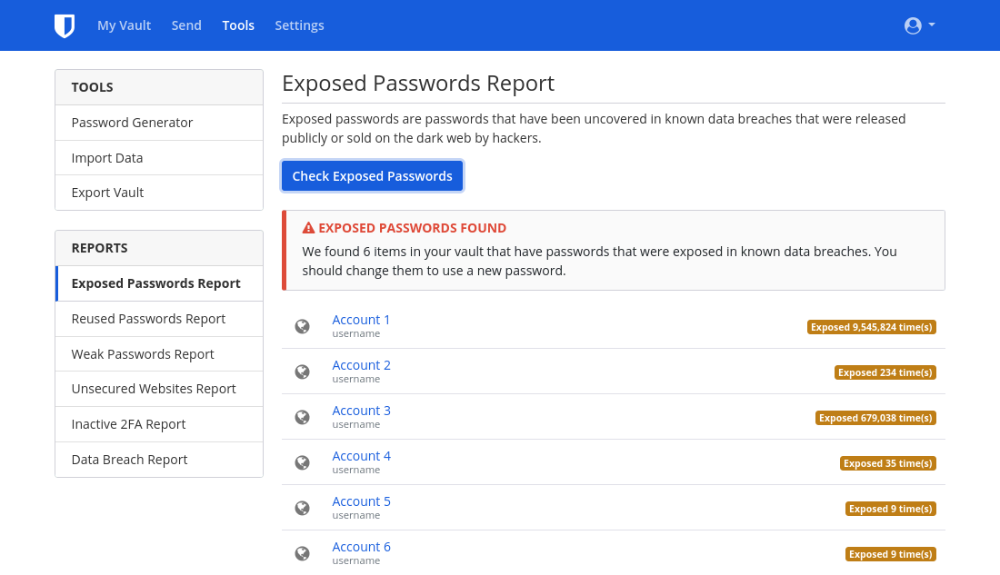

随着时间的推移，很容易积累一些在线账户，其中许多账户你可能不再使用。删除这些不再使用的账户，是重新掌控个人隐私的重要一步，因为长期不活动的账户更容易受到数据泄露的威胁。数据泄露是指一项服务的安全性受到损害，受保护的信息被未经授权的人查看、传输或窃取。遗憾的是，如今数据泄露[事件屡见不鲜](https://haveibeenpwned.com/PwnedWebsites)，因此养成良好的数字安全习惯是最大限度减少其对您生活影响的最佳方式。因此，本指南旨在帮助您顺利完成账户删除这一令人头疼的过程——该过程往往因[误导性的设计](https://deceptive.design)而变得困难重重——从而优化您的在线生活。

## 查找旧帐户

### 密码管理器

如果您有一个贯穿整个数字生活来使用的密码管理器，这个部分将非常简单。通常，它们会内置检测功能，用于查明您的凭据是否在数据泄露事件中遭到泄露——例如 Bitwarden[的“数据泄露报告”](https://bitwarden.com/blog/have-you-been-pwned)。

<figure markdown>
  
</figure>

即使你之前从未明确使用过密码管理器，也有可能在不知不觉中使用过浏览器（[Firefox](https://support.mozilla.org/kb/password-manager-remember-delete-edit-logins)、[Chrome](https://passwords.google.com/intro)、[Edge](https://support.microsoft.com/microsoft-edge/save-or-forget-passwords-in-microsoft-edge-b4beecb0-f2a8-1ca0-f26f-9ec247a3f336)）或手机（原生安卓系统的[Google 密码管理器](https://passwords.google.com/intro)、iOS 系统的[“密码”应用](https://support.apple.com/HT211146)）中内置的密码管理功能。

桌面平台通常也有一个密码管理器，可以帮助你恢复你忘记的密码。

- Windows：[凭据管理器](https://support.microsoft.com/windows/accessing-credential-manager-1b5c916a-6a16-889f-8581-fc16e8165ac0)
- macOS：[密码](https://support.apple.com/HT211145)
- Linux: Gnome Keyring (accessed through [Seahorse](https://gitlab.gnome.org/GNOME/seahorse#seahorse)) or [KDE Wallet Manager](https://userbase.kde.org/KDE_Wallet_Manager)

### 电子邮箱

如果您过去没有使用过密码管理器，或者您认为有些账户从未添加到密码管理器中，另一种方法是搜索您认为曾用于注册的电子邮件账户。在你的电子邮件客户端，搜索关键词，如 "验证 "或 "欢迎"。几乎每次您创建在线帐户时，注册的服务都会向您的电子邮箱发送验证链接或介绍性消息。这可能是找到被遗忘的旧账户的一个好方法。

## 删除旧账户

### 登录

为了删除你的旧账户，你需要首先确保你能登录到这些账户。同样，如果该账户是在你的密码管理器中，这一步很容易。如果没有，你可以尝试猜测你的密码。如果做不到这一点，通常可以选择重新获得你账户的访问权限，通常可以通过登录页面上的 "忘记密码 "链接获得。也有可能你放弃的账户已经被删除了--有时服务机构会裁除所有旧账户。

当试图重新获得访问权时，如果网站返回错误信息说该电子邮件没有与一个账户相关联，或者你在多次尝试后从未收到重置链接，那么你在该邮箱地址下没有账户，应该尝试另一个地址。如果你无法找出你使用的电子邮件地址，或者你不再能访问该电子邮件，你可以尝试联系该服务的客户支持。很遗憾，我们无法保证您能够恢复对账号的访问权限。

### GDPR（仅限欧洲经济区居民）

《通用数据保护条例》（GDPR）[第17条](https://gdpr-info.eu/art-17-gdpr)规定，欧洲经济区（EEA）居民在数据删除方面享有额外权利。如果适用于你，请阅读任何特定服务的隐私政策，以找到关于如何行使你的删除权的信息。阅读隐私政策可能被证明是重要的，因为一些服务有一个 "删除账户 "的选项，它只是禁用你的账户，而要真正删除，你必须采取额外行动。有时，实际删除可能涉及填写调查表、向服务的数据保护人员发送电子邮件，甚至证明你在欧洲经济区拥有住所。如果你打算这么做， **不要** 覆盖账户信息--你作为欧洲经济区居民的身份可能被要求。请注意，服务的地点并不重要；GDPR适用于任何为欧洲用户服务的人。如果该服务未尊重您的数据删除权，您可以联系您所在国家[的数据保护机构](https://ec.europa.eu/info/law/law-topic/data-protection/reform/rights-citizens/redress/what-should-i-do-if-i-think-my-personal-data-protection-rights-havent-been-respected_en)，并可能有权获得经济赔偿。

### 覆盖账户信息

在某些情况下，如果你打算放弃一个账户，用假数据覆盖账户信息可能是有意义的。一旦你确定你可以登录，将你账户中的所有信息改为伪造的信息。原因是许多网站会保留你以前的信息，即使是在删除账户后。这一方法寄希望于他们能用你输入的最新数据来覆盖以前的信息。但是，无法保证不会使用以前的信息进行备份。

对于账户邮箱，您可以通过您选择的邮箱服务商创建一个新的备用邮箱，或者使用[邮箱别名服务](../email-aliasing.md)创建一个别名。一旦完成，您可以删除备用电子邮件地址。我们建议不要使用临时电子邮件供应商，因为很多时候这类临时电子邮件有可能被重新激活。

### 删除

你可以查看 [JustDeleteMe](https://justdeleteme.xyz) ，了解关于删除特定服务的账户的说明。有些网站会慷慨地提供“删除帐户”选项，而其他网站则会迫使您与客服代表交谈。删除过程可能因网站而异，在一些网站上无法删除账户。

对于不允许删除账户的服务，最好的办法是像前面提到的那样伪造你的所有信息，加强账户安全。要做到这一点，请启用 [MFA](multi-factor-authentication.md) 和提供的任何额外安全功能。同样，将密码更改为随机生成的最大允许大小（ [密码管理器](/passwords/#local-password-managers) 对此很有用）。

如果你对所有你关心的信息都被删除感到满意，你可以安全地忘记这个账户。如果没有，把凭证与你的其他密码存放在一起，偶尔重新登录以重置密码可能是一个好主意。

即使你能够删除一个账户，也不能保证你的所有信息都会被删除。事实上，一些公司被法律要求保留某些信息，特别是与金融交易有关的信息。当涉及到网站和云服务时，你的数据会发生什么大多是你无法控制的。

## 避免新账户

老话说，"上医治未病"。每当你觉得被诱惑去注册一个新账户时，问问自己，"我真的需要这个吗？没有账户，我可以完成我需要的东西吗？"删除一个账户往往比创建一个账户要难得多。即使您删除了账户信息或对其进行了修改，第三方（例如[互联网档案馆](https://archive.org)）可能仍会保留该信息的缓存版本。当你能够避免诱惑时--你未来的自己会感谢你的。
